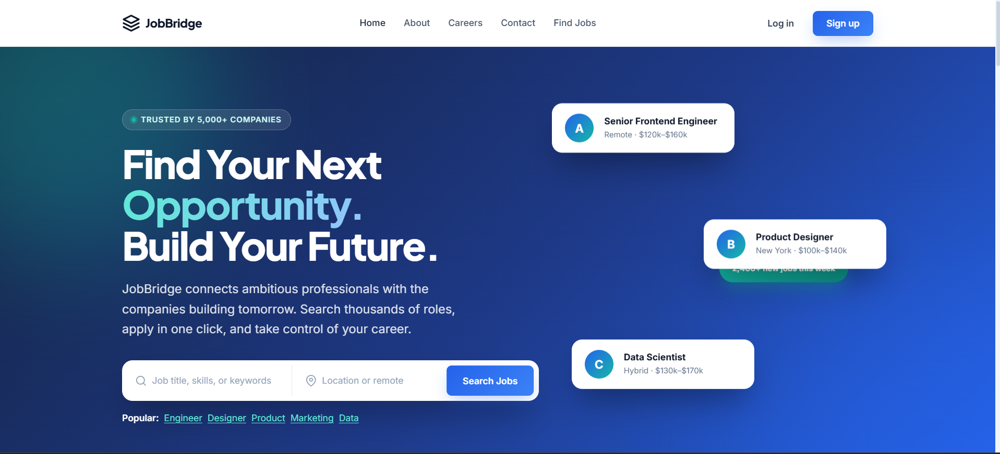
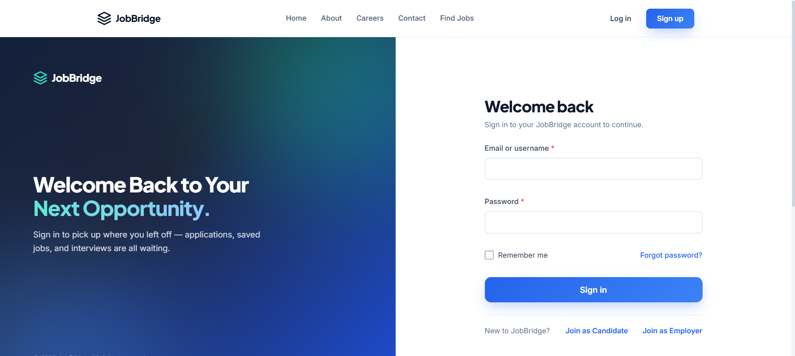
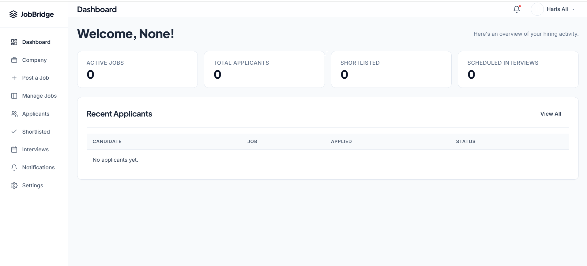
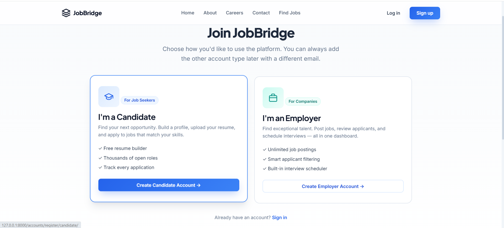

# JobBridge 🌉

## 📸 Screenshots

### Homepage & Marketing

*The modern, responsive landing page for JobBridge.*

### Login & Authentication

*Split-screen login experience with JWT authentication.*

### Employers Dashboard

*Track applications, manage profiles, and view saved jobs.*

### SignUp Page

*Candiates and Exployees can Register*

**Connecting Talent with Opportunity**

JobBridge is a modern, full-stack job portal platform built with **Python, Django 5, Django REST Framework (DRF), HTML5, CSS3, and Vanilla JavaScript**.

The platform connects job seekers with employers through dedicated candidate and employer experiences, while providing administrators with tools to manage the recruitment ecosystem. JobBridge uses a modular Django backend, a responsive frontend, RESTful APIs, and a relational database to provide a scalable foundation for recruitment and job management.

------------------------------------------------------------------------

## 📖 Table of Contents
1. [Project Overview](#-project-overview)
2. [Features](#-features)
3. [Technology Stack](#️-technology-stack)
4. [System Architecture](#️-system-architecture)
5. [Project Structure](#-project-structure)
6. [Database Design](#️-database-design)
7. [Authentication and Authorization](#-authentication-and-authorization)
8. [API Documentation](#-api-documentation)
9. [Installation and Setup](#-installation-and-setup)
10. [Environment Variables](#️-environment-variables)
11. [Running the Application](#️-running-the-application)
12. [Testing](#-testing)
13. [Deployment](#-deployment)
14. [Security](#-security)
15. [Future Improvements](#-future-improvements)
16. [License](#-license)

---

## 🌟 Project Overview

JobBridge is designed to simplify the recruitment process by bringing candidates and employers together on a single platform.

*   **Candidates** can create professional profiles, upload resumes, discover job opportunities, submit applications, and track their recruitment progress.
*   **Employers** can create company profiles, publish job vacancies, manage job listings, review applications, shortlist candidates, and organize interviews.
*   **Administrators** can oversee platform activities, manage users, moderate job listings, and monitor overall system performance.

### Main User Roles

| Role | Responsibilities |
| :--- | :--- |
| **Candidate** | Create profiles, search jobs, apply, and track applications. |
| **Employer** | Manage companies, publish jobs, and review applicants. |
| **Administrator** | Manage users, jobs, companies, and platform operations. |

---

## ✨ Features

### 👨‍💻 Candidate Features
*   Candidate registration and login.
*   Professional candidate profile management.
*   Profile picture and resume uploads.
*   Education and work experience management.
*   Technical and professional skills management.
*   Job searching and filtering.
*   Job details and company information.
*   Save jobs for later.
*   Apply for job opportunities.
*   Submit cover letters.
*   Track application progress and history.
*   Receive application notifications.

### 🏢 Employer Features
*   Employer registration and authentication.
*   Company profile creation and management.
*   Company logo and information management.
*   Create and publish job vacancies.
*   Edit, update, and delete job listings.
*   Manage active and inactive vacancies.
*   View applications received.
*   Search and filter applicants.
*   Review candidate profiles and resumes.
*   Shortlist or reject applicants.
*   Manage recruitment statuses.
*   Schedule candidate interviews.

### 🛡️ Administrator Features
*   Secure Django administration.
*   User management.
*   Candidate and employer management.
*   Company verification and moderation.
*   Job listing management.
*   Application monitoring.
*   Category management.
*   Platform statistics and reports.
*   Administrative oversight.

### 🌐 General Platform Features
*   Responsive and modern user interface.
*   Reusable HTML components and layouts.
*   Custom CSS design system.
*   Vanilla JavaScript interactions.
*   Django REST Framework APIs.
*   JWT-based API authentication.
*   Django session authentication for web pages.
*   Email verification workflows.
*   Password reset functionality.
*   Role-based permissions.
*   In-app notifications.
*   Secure file uploads.
*   Search, filtering, and pagination.

---

## 🛠️ Technology Stack

### Backend
| Technology | Purpose |
| :--- | :--- |
| Python 3.11+ | Main programming language |
| Django 5.x | Backend web framework |
| Django REST Framework | REST API development |
| Simple JWT | JWT authentication |
| django-filter | API filtering |
| Gunicorn | Production WSGI server |

### Frontend
| Technology | Purpose |
| :--- | :--- |
| HTML5 | Website structure |
| CSS3 | Styling and responsive layouts |
| Vanilla JavaScript | Frontend functionality |
| Fetch API | Backend API communication |
| CSS Variables | Reusable design system |
| Google Fonts | Typography |

### Database and Storage
| Technology | Purpose |
| :--- | :--- |
| PostgreSQL | Production relational database |
| SQLite | Local development database option |
| Django ORM | Database operations |
| Django File Storage | Resume and media management |

### Development and Deployment
| Technology | Purpose |
| :--- | :--- |
| Git | Version control |
| GitHub | Source code management |
| Docker | Application containerization |
| Docker Compose | Multi-container management |
| Nginx | Reverse proxy and static file serving |
| Pytest | Automated testing |
| Playwright | End-to-end browser testing |

---

## 🏗️ System Architecture

JobBridge follows a **modular Django monolithic architecture** with a separate presentation layer and REST API layer. The same Django project handles both HTML page rendering and API requests.

### Architecture Components

**1. Frontend Layer**
*   HTML pages rendered through Django templates.
*   Custom CSS for styling and responsive layouts.
*   Vanilla JavaScript for dynamic interactions.
*   Fetch API for asynchronous communication with backend endpoints.

**2. Backend Layer**
*   Django handles application logic and server-side rendering.
*   Django REST Framework handles API requests and responses.
*   Serializers validate and transform API data.
*   Models define database entities.
*   Views and services handle application operations.
*   Permissions enforce user access restrictions.

**3. Database Layer**
*   PostgreSQL for production.
*   SQLite as an optional development database.
*   Django ORM for database queries and relationships.

**4. Authentication Layer**
*   Django sessions for browser-based authentication.
*   JWT access and refresh tokens for REST API authentication.
*   Role-based permissions for candidates, employers, and administrators.

### Request Flow

```text
             USER
               |
               v
       FRONTEND INTERFACE
       HTML + CSS + JavaScript
               |
               v
        DJANGO APPLICATION
               |
        +------+------+
        |             |
        v             v
    HTML VIEWS     REST API
        |             |
        |             v
        |           DRF
        |             |
        |        SERIALIZERS
        |             |
        +------+------+
               |
               v
          DJANGO ORM
               |
               v
          DATABASE
        PostgreSQL
```

---

## 📂 Project Structure

The following structure represents the recommended organization of the JobBridge application.

```text
JobBridge/
│
├── backend/
│   │
│   ├── apps/
│   │   ├── accounts/
│   │   ├── candidates/
│   │   ├── companies/
│   │   ├── jobs/
│   │   ├── applications/
│   │   ├── interviews/
│   │   ├── notifications/
│   │   ├── reviews/
│   │   └── admin_panel/
│   │
│   ├── common/
│   │   ├── permissions/
│   │   ├── mixins/
│   │   ├── exceptions/
│   │   └── validators/
│   │
│   ├── config/
│   │   ├── settings/
│   │   │   ├── __init__.py
│   │   │   ├── base.py
│   │   │   ├── development.py
│   │   │   └── production.py
│   │   ├── urls.py
│   │   ├── asgi.py
│   │   └── wsgi.py
│   │
│   ├── templates/
│   ├── static/
│   ├── media/
│   ├── tests/
│   ├── manage.py
│   ├── requirements.txt
│   ├── pytest.ini
│   ├── .env.example
│   └── .gitignore
│
├── docker-compose.yml
├── .gitignore
├── LICENSE
└── README.md
```

---

## 🗄️ Database Design

JobBridge uses Django ORM to manage database operations and relationships.

**1. User (`accounts.User`)**
Custom user model extending Django's authentication system. Email is used as the primary login identifier. Roles include Candidate and Employer. Administrative access is controlled through Django staff and superuser permissions.

**2. CandidateProfile (`candidates.CandidateProfile`)**
One-to-one relationship with User. Stores profile information, resume, profile picture, biography, skills, education, work experience, and portfolio URL.

**3. Company (`companies.Company`)**
Stores company name, description, logo, website, industry, location, and employer relationship.

**4. Job (`jobs.Job`)**
Stores job title, description, requirements, responsibilities, salary range, location, employment type, experience level, company relationship, category relationship, and publication status.

**5. Application (`applications.Application`)**
Connects a CandidateProfile to a Job. Stores candidate, job, cover letter, application status, and application date. A unique database constraint prevents the same candidate from applying to the same job more than once.

**6. Interview (`interviews.Interview`)**
Connects an interview to an application. Stores interview date/time, meeting link, type, status, and notes.

**7. Notification (`notifications.Notification`)**
Stores user notifications, including title, message, type, read/unread status, and creation timestamp.

---

## 🔐 Authentication and Authorization

JobBridge uses two authentication mechanisms:

**1. Django Session Authentication**
Used for browser-based pages and dashboards. Login creates an authenticated session. Protected pages require authentication. Logout terminates the session. CSRF protection is enabled for unsafe requests.

**2. JWT Authentication**
Used for REST API authentication through Django REST Framework and Simple JWT. JWT consists of an Access token and a Refresh token.

Example API request:
```http
GET /api/v1/jobs/
Authorization: Bearer YOUR_ACCESS_TOKEN
```

### Role-Based Access Control

| Permission | Candidate | Employer | Admin |
| :--- | :--- | :--- | :--- |
| View public jobs | Yes | Yes | Yes |
| Apply for jobs | Yes | No | As authorized |
| Save jobs | Yes | No | As authorized |
| Create job listings | No | Yes | Yes |
| Manage company | No | Yes | Yes |
| View applicants | No | Yes | Yes |
| Manage platform users| No | No | Yes |

*All permissions must also be enforced on the backend, not just hidden in the frontend.*

---

## 🔌 API Documentation

**Base API URL:** `http://127.0.0.1:8000/api/v1/`

### Authentication Endpoints
| Method | Endpoint | Description |
| :--- | :--- | :--- |
| POST | `/accounts/register/` | Register an account |
| POST | `/accounts/login/` | Authenticate user |
| POST | `/accounts/token/refresh/` | Refresh JWT token |
| POST | `/accounts/logout/` | Logout / token invalidation |
| POST | `/accounts/password/reset/` | Request password reset |
| POST | `/accounts/password/reset/confirm/` | Confirm password reset |

### Job Endpoints
| Method | Endpoint | Description |
| :--- | :--- | :--- |
| GET | `/jobs/` | List available jobs |
| GET | `/jobs/{id}/` | Retrieve job details |
| POST | `/jobs/` | Create a job |
| PUT/PATCH | `/jobs/{id}/` | Update a job |
| DELETE | `/jobs/{id}/` | Delete a job |
| GET | `/jobs/categories/` | List job categories |
| POST | `/jobs/{id}/save/` | Save a job |

### Application Endpoints
| Method | Endpoint | Description |
| :--- | :--- | :--- |
| POST | `/applications/` | Submit a job application |
| GET | `/applications/` | List applications |
| GET | `/applications/{id}/` | View application details |
| PATCH | `/applications/{id}/status/` | Update application status |

### Standard API Response
```json
{
    "success": true,
    "message": "Jobs retrieved successfully.",
    "data": []
}
```

---

## 🚀 Installation and Setup

### Prerequisites
*   Python 3.11 or later.
*   Git.
*   pip.
*   PostgreSQL (if using PostgreSQL locally).
*   A code editor such as Visual Studio Code.

### 1. Clone the Repository
```bash
git clone https://github.com/YOUR_USERNAME/JobBridge.git
cd JobBridge
```

### 2. Navigate to Backend and Create Virtual Environment
```bash
cd backend
```

**Windows PowerShell:**
```powershell
python -m venv .venv
.\.venv\Scripts\Activate.ps1
```

**Linux/macOS:**
```bash
python3 -m venv .venv
source .venv/bin/activate
```

### 3. Install Dependencies
```bash
python -m pip install --upgrade pip
pip install -r requirements.txt
```

### 4. Configure Environment Variables
**Windows:**
```powershell
Copy-Item .env.example .env
```
**Linux/macOS:**
```bash
cp .env.example .env
```
*Update the environment variables according to your local configuration.*

### 5. Run Database Migrations
```bash
python manage.py makemigrations
python manage.py migrate
```

### 6. Create Administrator Account
```bash
python manage.py createsuperuser
```

### 7. Run Development Server
```bash
python manage.py runserver
```
The application is accessible at:
*   **Website:** `http://127.0.0.1:8000/`
*   **Django Admin:** `http://127.0.0.1:8000/admin/`
*   **API:** `http://127.0.0.1:8000/api/v1/`

---

## ⚙️ Environment Variables

The `.env` file stores sensitive configuration values.

Example `.env.example`:
```env
# Django Configuration
DJANGO_SECRET_KEY=replace-with-a-secure-secret-key
DJANGO_DEBUG=True
DJANGO_ALLOWED_HOSTS=localhost,127.0.0.1

# Django Settings Module
DJANGO_SETTINGS_MODULE=config.settings.development

# Database Configuration
DATABASE_URL=sqlite:///db.sqlite3

# Email Configuration
EMAIL_BACKEND=django.core.mail.backends.console.EmailBackend
DEFAULT_FROM_EMAIL=noreply@jobbridge.local

# Frontend Configuration
FRONTEND_URL=http://127.0.0.1:8000

# JWT Configuration
JWT_ACCESS_TOKEN_LIFETIME=15
JWT_REFRESH_TOKEN_LIFETIME=7
```

*Important: Never commit your actual `.env` file or expose your Django secret key.*

---

## 🐳 Deployment

JobBridge is designed to support deployment using Docker, Gunicorn, PostgreSQL, and Nginx.

### Docker Deployment
From the project root:
```bash
docker compose up -d --build
```
Check running containers:
```bash
docker compose ps
```

### Manual Deployment (Ubuntu)
1. Install Python and required system packages.
2. Install and configure PostgreSQL.
3. Create a production database and database user.
4. Configure production environment variables.
5. Install Python dependencies.
6. Run Django migrations.
7. Collect static files (`python manage.py collectstatic`).
8. Configure Gunicorn (`gunicorn --workers 3 --bind 127.0.0.1:8000 config.wsgi:application`).
9. Configure Nginx as a reverse proxy.
10. Enable HTTPS using a valid SSL certificate.

---

## 🔒 Security

Recommended production security configurations:
*   Set `DEBUG=False`.
*   Use a strong and private `SECRET_KEY`.
*   Configure `ALLOWED_HOSTS`.
*   Enable HTTPS and `SECURE_SSL_REDIRECT=True`.
*   Enable secure session and CSRF cookies.
*   Validate uploaded files.
*   Apply role-based permissions on every protected API.
*   Use environment variables for credentials.
*   Run `python manage.py check --deploy` to catch issues.

---

## 📄 License

This project is licensed under the MIT License. See the [LICENSE](LICENSE) file for details.

---

## 👨‍💻 Author

**JobBridge — Connecting Talent with Opportunity**

Built with Python, Django, Django REST Framework, HTML, CSS, and JavaScript.

**GitHub:** [https://github.com/YOUR_USERNAME/JobBridge](https://github.com/YOUR_USERNAME/JobBridge)

⭐ If you find this project useful, consider giving it a star on GitHub.